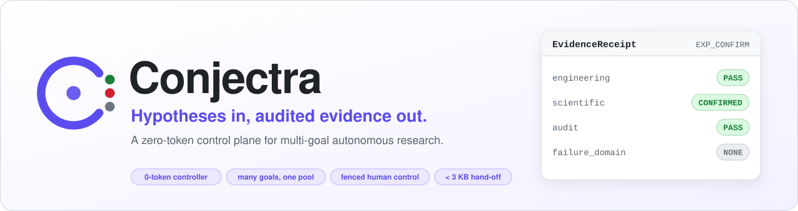
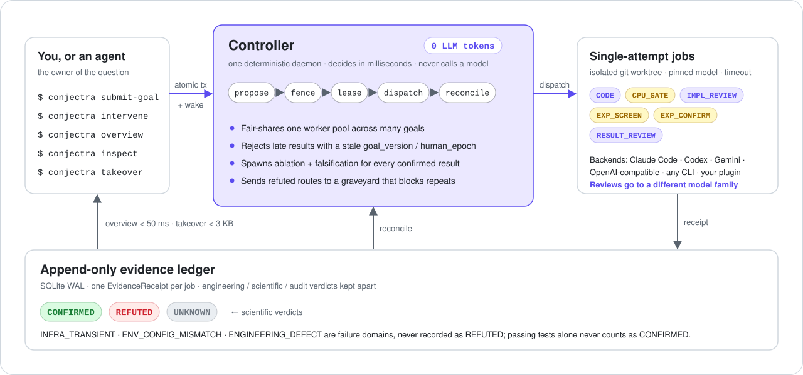
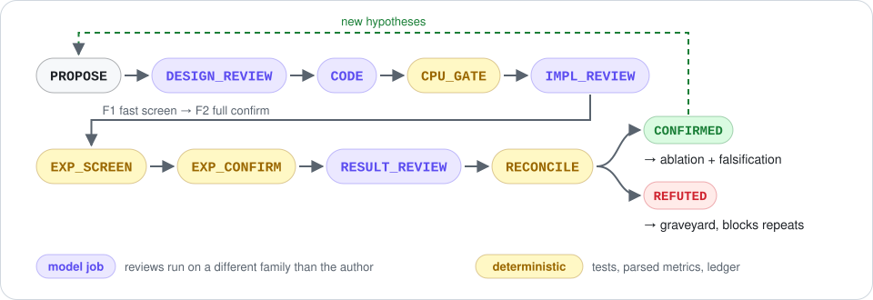

<p align="center">
  <picture>
    <source media="(prefers-color-scheme: dark)" srcset="docs/assets/banner-dark.svg">
    
  </picture>
</p>

<p align="center">
  <a href="https://github.com/xixilys/conjectra/actions/workflows/ci.yml"></a>
  <a href="LICENSE"></a>
  
  
  
  
</p>

<p align="center">
  <a href="#quickstart">Quickstart</a> ·
  <a href="#see-it-run">See it run</a> ·
  <a href="#how-it-works">How it works</a> ·
  <a href="#how-it-compares">Compare</a> ·
  <a href="#documentation">Docs</a>
</p>

**Conjectra lets coding agents run research experiments unattended, while a deterministic
controller that never calls a model decides what runs next, and an append-only ledger records, with
receipts, what was actually *confirmed*, what was *refuted*, and what is still *unknown*.**

You point it at a git repository and a metric. It turns the goal into falsifiable hypotheses, runs
every step as a short, isolated, single-attempt job, attacks every result it confirms, and lets you
(or another agent) pause, steer or take over at any moment without losing track.

The name comes from Karl Popper's *Conjectures and Refutations*: a hypothesis only counts once it
has survived a real attempt to kill it.

---

## Why

LLM agents are good at writing code and bad at being honest about results. Conjectra keeps the
models doing the work and takes the decisions and the bookkeeping away from them:

| Long-running agent loops tend to… | Conjectra instead… |
|---|---|
| spend tokens deciding what to do next | decides with one deterministic daemon: **0 LLM tokens**, milliseconds per step |
| call a flaky run a win, or a crash a refutation | keeps **engineering, scientific and audit verdicts apart**; infrastructure, environment and engineering failures are *failure domains*, never "refuted" |
| grade their own homework | sends design, implementation and result reviews to a **different model family**, on read-only snapshots |
| forget what was already tried | puts refuted routes in a **graveyard** that rejects duplicates, and automatically spawns **ablation + falsification** branches for every confirmed result |
| let a late result overwrite your decision | **fences** every human intervention with a `human_epoch`; results from before it are rejected |
| live and die inside one chat session | keeps all state in a SQLite WAL ledger: `overview` answers in **< 50 ms**, `takeover` writes a **< 3 KB** brief anyone can resume from |

## Quickstart

Requirements: **Python ≥ 3.10** and **git**. No API keys, no network, no HyperQueue, and no
`pip install` needed for the demo (the runtime is standard-library only).

```bash
git clone https://github.com/xixilys/conjectra && cd conjectra
./examples/quickstart/run.sh        # ~30 s, fully offline
```

> On macOS, `/usr/bin/python3` may still be 3.9. Put a newer `python3` first on `PATH`
> (Homebrew, pyenv, uv, conda…) or `pip install -e .` into a 3.10+ environment.

The script builds a toy repository whose test prints `METRIC score=<value>`, registers the goal
*"maximize score"*, runs the controller inline for 20 s with a tiny offline backend playing the
engineer and the reviewers, prints the ledger, writes a takeover brief, and finally pauses the goal
as a human would.

## See it run

<p align="center">
  
</p>

<sub>An unedited recording of the command above on a laptop (macOS, Python 3.13, no HyperQueue),
made with asciinema + svg-term. Only the silent 20-second controller run is shortened to 2.5 s; every
line and number is real output. Timing-dependent counts vary slightly from run to run.</sub>

What happened in those 20 seconds:

* **3 starting hypotheses grew to 12.** One came from `proposals.json`, two were seeded by the
  project adapter. Confirmed results spawned their own `ABLATION` (does the change actually matter?)
  and `FALSIFICATION` (can a stress test break it?) branches (4 of each), plus one refinement.
* **49 evidence receipts**, one per finished job: code commits in isolated worktrees, deterministic
  test gates, fast-screen and full-confirm experiments, implementation and result reviews, and
  reconcile steps, each recorded with its own verdicts.
* **`tokens=0/100000`**: the controller itself never spends tokens; here the backend is an offline
  toy, so no job does either. With real backends, jobs draw from each goal's token budget.
* **A human pause took effect instantly**: `status=PAUSED`, `human_epoch` 0 → 1. Any result started
  before the pause is now fenced off instead of silently overwriting the decision.

The toy backend always improves the code and its reviewers always pass, so every hypothesis being
confirmed is expected here; the demo shows the *pipeline*, not a scientific result. Failures look
like this instead. On a machine that could not provide the memory a test gate asked for, the ledger
recorded:

```json
{"stage": "CPU_GATE", "process_status": "ENV_ERROR", "engineering_verdict": "SKIPPED",
 "scientific_verdict": "UNKNOWN", "failure_domain": "ENV_CONFIG_MISMATCH",
 "failure_reason": "MEM_BELOW_10GB_TIMEOUT", "evidence_validity": "MISSING_INPUT"}
```

The environment failed, so the hypothesis is *unknown*, not *refuted*, and it stays eligible.

<details>
<summary>Plain-text output of the recording</summary>

```text
$ ./examples/quickstart/run.sh
== 1. toy repo
== 2. init ledger + submit goal
submitted goal: demo-score
accepted proposals: 1 | enqueued tasks: 1
== 3. run the controller inline for a few seconds
== 4. what happened
goal demo-score: status=ACTIVE receipts=49 tokens=0/100000 human_epoch=0
overview latency: 9.306 ms
12 hypotheses; verdicts: {'CONFIRMED': 12}
  [     CONFIRMED] COMPETING_ROUTE  toy primary algorithmic improvement route
  [     CONFIRMED] PARAMETER_RACE   More Newton iterations
  [     CONFIRMED] PARAMETER_RACE   toy parameter calibration race
  [     CONFIRMED] ABLATION         Ablation of More Newton iterations
  [     CONFIRMED] ABLATION         Ablation of toy parameter calibration race
  [     CONFIRMED] FALSIFICATION    Falsification stress on More Newton iterations
recent receipts by stage: CODE=3 CPU_GATE=5 IMPL_REVIEW=1 EXP_SCREEN=7 EXP_CONFIRM=1 RESULT_REVIEW=2 RECONCILE=1
takeover brief:     1441 bytes -> /tmp/conjectra/.conjectra-demo/takeover.md
== 5. human intervention: pause the goal
goal demo-score: status=PAUSED receipts=49 tokens=0/100000 human_epoch=1
overview latency: 2.382 ms
done.
```

</details>

## How it works

<p align="center">
  <picture>
    <source media="(prefers-color-scheme: dark)" srcset="docs/assets/how-it-works-dark.svg">
    
  </picture>
</p>

A hypothesis moves through stages. Each stage is a separate job with its own resources, timeout and
receipt; retries are new jobs, never in-place re-runs.

<p align="center">
  <picture>
    <source media="(prefers-color-scheme: dark)" srcset="docs/assets/pipeline-dark.svg">
    
  </picture>
</p>

Under the hood:

* **Multi-goal scheduling**: many goals share one worker pool with guaranteed slots, elastic
  borrowing, aging and a foreground reserve for interactive use.
* **Pluggable model backends**: Claude Code, Codex CLI, Gemini CLI, any OpenAI-compatible endpoint,
  any command-line tool, or your own Python plugin. A deterministic `fake` backend makes the whole
  pipeline testable offline.
* **Policy-driven model routing**: one router validates every route against a provider catalog.
  Policies can be structured JSON or natural language
  (`"theory work uses Opus xhigh, routine analysis uses gpt-5-codex high"`), with `HARD` vs
  `SOFT_FALLBACK` semantics and quota awareness.
* **Human-in-the-loop**: `pause`, `resume`, `rebalance_goals`, `update_objective`, `prune_branch`,
  `focus`, `inject_hypothesis`, `override_verdict` and more are atomic SQLite transactions.
* **SubGoal portfolios**: complex goals can split into independent tracks with local metrics,
  dependency locks, weighted non-starvation scheduling, per-track `TrackLead` reviews on `< 3 KB`
  digests and portfolio-level `ApexDirector` actions (`spawn`, `retune`, `merge`, `kill`, `sync`).
* **Real job execution**: production runs go through
  [HyperQueue](https://github.com/It4innovations/hyperqueue) with resource-aware placement (CPU, RAM,
  GPU, LLM pool slots) and host guards for memory and disk; `--mode inline` runs everything
  in-process for development.

More detail: [Architecture](docs/architecture.md) · [Concepts](docs/concepts.md)

## Use it on your own repository

```bash
pip install -e .                                    # or run ./bin/conjectra from the checkout
conjectra init-pilot --no-ssh
conjectra submit-goal --file my_goal.json           # see examples/quickstart/goal.json
conjectra import-proposals --file proposals.json    # optional: your own hypotheses
conjectra daemon --mode inline --propose-mode seeds --max-seconds 600
conjectra overview
conjectra inspect --goal-id my-goal
conjectra intervene --scope goal --goal-id my-goal --action pause --reason "need to look"
conjectra takeover --goal-id my-goal --format markdown
```

For real model calls, install the CLIs you want to use (`claude`, `codex`, `gemini`) or point the
`openai_compat` backend at an endpoint, and unset `CONJECTRA_BACKEND_OVERRIDE`. For parallel
production runs, install HyperQueue (`hq` on `PATH`) and use `--mode hq` (the default). Host guards
(free RAM, disk high-water mark) are tuned for servers; see
[Configuration](docs/configuration.md#host-guards) to relax them on a laptop.

| Example | What it shows |
|---|---|
| [`examples/quickstart`](examples/quickstart) | Full offline closed loop on a toy repo, human pause, takeover brief |
| [`examples/custom_backend`](examples/custom_backend) | Writing and registering a model backend plugin (code, env var, entry point) |
| [`examples/custom_adapter`](examples/custom_adapter) | A project adapter that seeds hypotheses and parses domain metrics |

## How it compares

Conjectra is a *control plane*, not an agent. It sits above the coding agents you already use and
below the human who owns the research question.

| | Conjectra | Agent frameworks (LangGraph, AutoGen, CrewAI, …) | Autonomous-research agents (e.g. AI-Scientist-style pipelines) | Workflow engines (Airflow, Prefect, Ray, HyperQueue) | Experiment trackers (MLflow, W&B) |
|---|---|---|---|---|---|
| Who decides what runs next | Deterministic controller, 0 tokens | An LLM in the loop | An LLM in the loop | Your DAG | You |
| Unit of work | Single-attempt, sandboxed job with pinned model route | Agent turn / tool call | Agent session | Task | Run |
| Scientific verdict semantics (confirmed / refuted / unknown, failure domains) | Built in | — | Partly, usually LLM-judged | — | — |
| Cross-family blind review of code and results | Built in | DIY | Rare | — | — |
| Many goals sharing one budget & worker pool | Built in | DIY | Usually one goal per run | Yes (generic) | — |
| Human interventions fenced against stale results | Built in (`human_epoch`) | DIY | — | Pause/kill | — |
| Model backends | Pluggable (CLI, HTTP, command, Python) | Pluggable | Usually fixed | n/a | n/a |

It complements these tools: HyperQueue is the execution layer, any coding agent can be a backend,
and metrics can still be logged to your tracker.

## Documentation

| Page | What's in it |
|---|---|
| [Concepts](docs/concepts.md) | goals, hypotheses, stages, receipts, verdicts, failure domains, epochs |
| [Architecture](docs/architecture.md) | components, data flow, fencing and recovery |
| [Backends](docs/backends.md) | the model / execution backend plugin interface |
| [Adapters](docs/adapters.md) | project adapters: seeds, commands, metric parsing |
| [Configuration](docs/configuration.md) | environment variables, provider catalog, quota files, host guards |
| [CLI reference](docs/cli.md) | every `conjectra` subcommand |

## Status & limitations

* **Alpha.** The runtime was extracted from a private deployment that runs several research goals
  unattended in parallel. APIs and the on-disk schema may still change; schema migrations so far
  are additive and automatic.
* POSIX only (Linux and macOS): it uses `fcntl`, process groups and unix sockets.
* The default provider catalog (`conjectra/data/providers.json`) lists example model ids; adjust
  them to what your CLIs and gateways actually accept.
* The natural-language routing-policy compiler understands English and Chinese keywords.

## Contributing

See [CONTRIBUTING.md](CONTRIBUTING.md). Please report security issues privately as described in
[SECURITY.md](SECURITY.md). The README artwork is generated by `scripts/gen_readme_assets.py`; see
[docs/assets/README.md](docs/assets/README.md) for how to re-record the demo.

## License

[Apache License 2.0](LICENSE)
